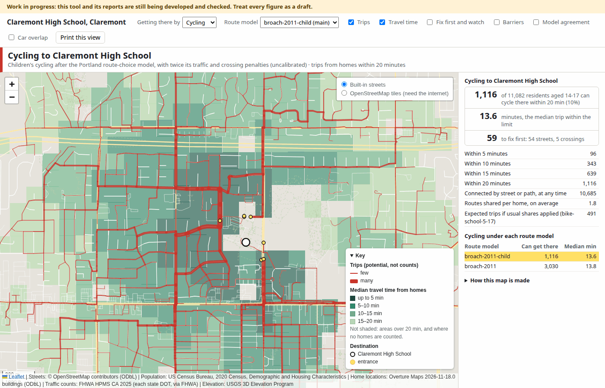
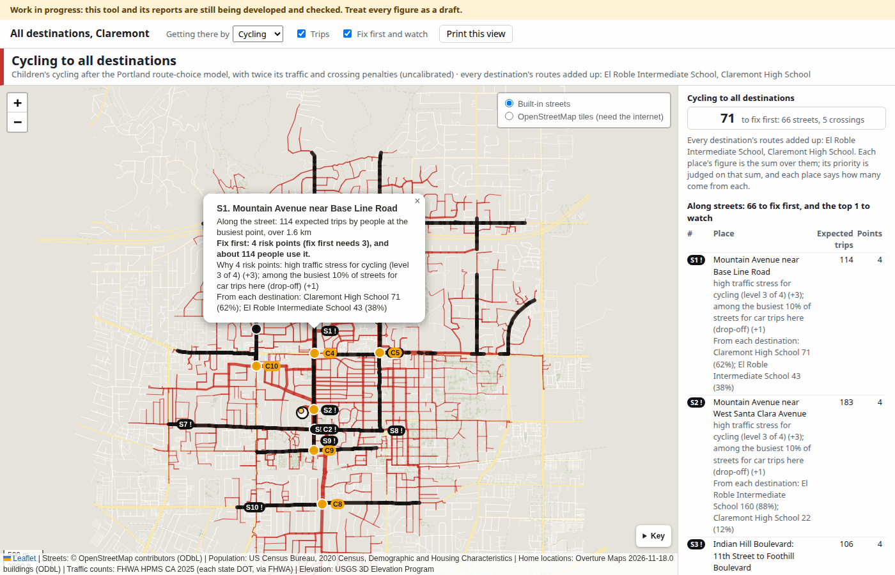
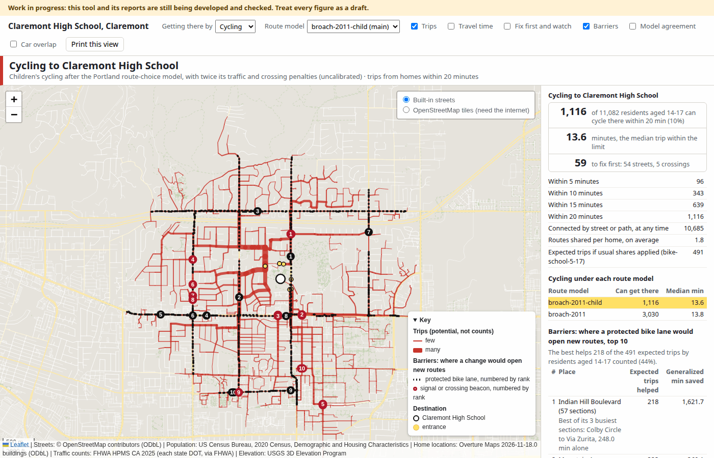

# walkbike-routes

> **Work in progress.** This project is under active development and not yet
> released. Its reports, maps and figures are drafts: check them before
> relying on or sharing them. Settings, file formats and outputs may change
> without notice.

**For a school, a downtown or any other destination, walkbike-routes asks
three questions. Which streets would people walk and cycle on to get there?
Where do those routes run into traffic today? And where would a change open
up new routes?**

It answers them from free public data, anywhere in the US. It is meant for
the people who decide where safety work goes: Safe Routes to School teams,
parent groups, city transportation staff and advocates. Instead of a hunch or
a complaint log, they get a map and a ranked list they can check street by
street.

## What it shows

### Where trips would go



Every home within reach is routed to the destination over the street network.
The routes come from models fitted to real walkers' and cyclists' GPS traces,
which trade distance off against busy streets, crossings and hills. Nearer
homes count more, as they do in the National Household Travel Survey. The
thick lines are the streets that matter most for getting there. The shading
shows how long the trip takes from each area.

### Where routes meet traffic today



Each street and crossing on those routes gets risk points from published risk
factors: traffic volume, speed, lanes to cross, missing sidewalks and
drop-off traffic. Where many people meet high risk, the place is marked
**fix first** (black, marked "!"); the rest with points are **watch**
(amber). Every place says why in plain words. In the picture, the top
street has 4 risk points for heavy traffic and drop-off cars, and about 114
riders' routes use it: 62% heading to the high school and 38% to the
intermediate school. With several destinations, their routes are added up, and
each place shows how much comes from each.

### Where a change would open new routes



Some homes are close by but cut off by a road nobody would choose to cross.
The improvement screen tries each change on the routes: a protected bike
lane, a sidewalk, a marked crosswalk, or a signal or crossing beacon. It
then ranks the places where each change would most improve the most
people's trips. Improvement is counted in generalized minutes, which add the
extra effort of busy streets and crossings to clock time. It's a guide to
where to look, not a design.

### Who can get there

The report gives the number of residents (or children of the right ages)
within 5, 10, 15 and 20 minutes on foot or by bike, under each route model,
and compares the models.

## What it is not

The flows are **potential**: where trips would concentrate if everyone within
reach made them. They are not counts of trips, a forecast or a measure of
crash risk. The risk points are hand-set from published guidance and have
not yet been checked against crash records. Use the results to decide where
to look, then go and look.

## How it works

- **Homes:** each 2020 Census block's residents, spread over the buildings
  in it that look like homes (Overture Maps footprints).
- **Streets:** OpenStreetMap, with traffic counts from the federal Highway
  Performance Monitoring System and hills from USGS elevation. A city's own
  sidewalk, signal, speed or bikeway layers can replace OSM's, and hand
  corrections fix what neither has.
- **Route choice:** published models of how people choose routes (Broach and
  colleagues' Portland models for walking and cycling, and Furth's traffic
  stress criteria), shortest-distance baselines to compare them with, and
  slower, more cautious child versions of the Portland models.
  The child versions are assumptions, not fitted to children's trips.
- **Distance:** fewer people walk or cycle the farther they have to go, by
  the 2017 National Household Travel Survey's curves for each trip purpose
  and age.
- **Checks:** the cycling models were compared with recorded Philadelphia
  trips; see [`validation/RESULTS.md`](validation/RESULTS.md). Walking has
  not yet been checked against observed routes.

[`docs/assumptions.md`](docs/assumptions.md) lists every assumption and its
source. [`docs/routing-methods.md`](docs/routing-methods.md) describes each
route-choice method, what was changed from its paper and how far it has been
checked. To set it up for your own town, see
[`docs/adapting.md`](docs/adapting.md).

The pictures above come from
[`config/claremont_schools.yaml`](config/claremont_schools.yaml), built from
public data only: © OpenStreetMap contributors (ODbL), US Census Bureau,
Overture Maps, USGS and FHWA. They show what the tool does. They are not a
study of these schools: Claremont High's entrances come from OpenStreetMap
and El Roble's trips end at the street nearest its centre, nobody has checked
either on the ground, and nobody local has reviewed the results.

## Try it

Needs [uv](https://docs.astral.sh/uv/).

```bash
uv sync
make demo        # builds the made-up demo town into output/demo
make check       # lint, types, tests
```

To build the Claremont example, set `CENSUS_API_KEY` (a free key; see
[`docs/adapting.md`](docs/adapting.md)) and run the command below. The
first run downloads about 700 MB of map data.

```bash
uv run walkbike-routes run --config config/claremont_schools.yaml --out output/claremont
```

Then open `output/claremont/claremont-high/map.html`.

## Reference

The rest of this page is the detail for running your own studies.

### A study config

A study is one YAML file, such as [`config/demo.yaml`](config/demo.yaml). It
names:

- the area;
- the destinations, with their entrances if needed;
- the modes;
- the route-choice presets for each mode, the first being the one the map
  shows first. The suggested defaults are `walk: [broach-2016]` and
  `bike: [broach-2011]`, route-choice models estimated from Portland
  walkers' and cyclists' GPS traces (the cycling one was the closest of the
  published presets to recorded Philadelphia trips; see
  [`validation/RESULTS.md`](validation/RESULTS.md)), and for an elementary
  school `broach-2016-child` and `broach-2011-child`, which are slower and
  avoid busy streets and crossings more, without ruling any out.
  `bike: [broach-2011-lanes]` also values bike lanes on quiet streets, and
  `walk: [broach-2016-sidewalks]` sidewalks on busier roads;
  `bike: [furth]` rates traffic stress by Furth's criteria tables, v2.2;
  `walk: [shortest]` and `bike: [shortest]` take the shortest route, as a
  baseline to compare the others with; see
  [`docs/routing-methods.md`](docs/routing-methods.md) for each method's
  source, changes and validation, and
  [`docs/assumptions.md`](docs/assumptions.md);
- the time limits for walking and cycling;
- who the trips start from: residents in an age range, or households.

A destination can also set its own `min_age` and `max_age` (an elementary
school and a high school in one study), and `serves`, an outline such as an
attendance area: then only homes inside it make trips there. An `outline`
does the same and is also drawn on the destination's map, and it can pick
one school's shapes from a file of several. With `limits: false` it is only
drawn, and every home within reach still counts:

```yaml
    outline:
      file: attendance_areas.geojson
      where: {SCHOOL: [Almond]}    # keep this school's shapes from a shared file
      name: Almond attendance area # its label on the map (default: Attendance area)
      credit: The school district  # printed with the map's sources (default: the file name)
      limits: true                 # only homes inside make trips here (default)
```

[`config/los_altos_schools.yaml`](config/los_altos_schools.yaml) has three
schools with their entrances and drop-off points.

Optional settings, each with a default that suits most studies:

- `time_bands_min` (5, 10, 15, 20): the bands the tables count homes within.
  None may be above a time limit, since routes are not searched past it.
- `screen_candidates` (25): how many sections the improvement screen scores;
  0 turns the screen off.
- `route_choice`: how a trip splits across routes. `routes` (3) is the most
  it may use, `maximum_cost_gap_s` (60) and `maximum_cost_ratio` (1.10) how
  much worse than the best a route may be, and `logit_scale_s` (60) how
  sharply trips favour the better route. See "Splitting trips across routes"
  in [`docs/assumptions.md`](docs/assumptions.md).
- `crs`: the projected coordinate system, in metres, to work in (such as
  `EPSG:26910`). By default the area's UTM zone is used.
- under `area`: `osm_file` names your own OpenStreetMap file (`.osm.pbf`,
  `.osm` or a saved Overpass `.json`) to use instead of a download, which
  keeps a study's streets fixed; `buildings: none` keeps one home point per
  Census block; `overture_release` pins the building data; and
  `traffic_counts: none` leaves traffic to be inferred from road class.

On the command line, `--data` says where downloads are kept (by default
`data/raw/<study>`), and `--refresh-osm` downloads OpenStreetMap again
instead of using the saved copy.

Unknown or missing settings are errors, and so is a setting that cannot
apply (a `place` for the demo town, say), a file that is not there, or a
destination outside the area.

### Distance decay

Fewer people walk or cycle the farther they have to go. Each home's
walking or cycling trips are weighted by the share of trips, nationally, for
that purpose that are at least as long as its route: from the 2017 National
Household Travel Survey, in `src/walkbike_routes/decay/`. A destination's
`purpose` picks the curves:

- `everyday` (the default): shopping, meals, errands, recreation and visits,
  adults;
- `school`: walking to school for the destination's ages (5–10, 11–13 or
  14–17), cycling to school for ages 5–17;
- `work`.

The time cap is still the farthest a trip goes. To name curves yourself or
turn decay off:

```yaml
distance_decay:
  walk: walk-school-14-17   # any curve in src/walkbike_routes/decay/
  bike: none                # no decay: everyone within the cap counts in full
# or, for every mode at once:
distance_decay: none
```

Catchment figures (the demand weight within each time band) are never decayed;
flows, screens and `expected_weight` in the summary are. See
[`docs/assumptions.md`](docs/assumptions.md#distance-decay-walking-and-cycling)
for the curves, their sample sizes and their limits.

### Flows across the whole network

A street counter sees trips to everywhere, not to one destination. To get a
flow pattern to compare with counts, add:

```yaml
network_flows:
  destinations: 80   # clusters of jobs to route to
  workers: 4         # route that many clusters at once
```

The run groups the area's jobs (Census LODES, by block) into clusters,
routes every home to each, shares each home's trips among the clusters by
jobs and distance decay, and adds up the flows in `out/network/`. With
`network_flows`, `destinations` may be an empty list. Cars are not
included. See [`docs/assumptions.md`](docs/assumptions.md#flows-across-the-whole-network-network_flows).
Routing many clusters takes a while at city scale.

### Checking against observed travel (experimental)

Checks of modelled flows against counts, and of each cycling preset's routes
against recorded trips, live apart from the package in
[`validation/`](validation/README.md). They import walkbike-routes as a
library and add nothing to it. What they found in Philadelphia is in
[`validation/RESULTS.md`](validation/RESULTS.md).

## What a run writes

`walkbike-routes run --config study.yaml --out out/` writes the layers
(`nodes`, `links`, `homes`, `destinations`, `access_points`), then for each
destination, mode and preset a folder `out/<destination>/<mode>-<preset>/`:

- `routes.parquet`: each home's best route, time and whether it fits the cap
  (walking and cycling also give its `decay_factor` and `expected_weight`);
- `route_shares.parquet`: walking and cycling trips split across up to three
  near-best routes with a path-size logit;
- `flows.parquet`: flow on each street, after decay for walking and cycling
  (cars: there, back and both);
- `entrances.parquet`: where trips end;
- `screen.parquet` (walking and cycling, first preset, when it routes by
  generalized cost rather than plain distance): the streets, crossings and
  junctions where each treatment would save the most time, ranked within
  each treatment: for cycling a protected bike lane, or a signal or
  crossing beacon (Broach presets); for walking a sidewalk (not for
  `walk/broach-2016`, which has no sidewalk term), a marked crosswalk, or a
  signal or crossing beacon. A screen of where to look, not a design.
- `exposure_streets.parquet` and `exposure_crossings.parquet` (walking and
  cycling, first preset): where routes meet traffic today. Streets and
  crossings are ranked separately, by flow × hand-set risk points (see
  "Where routes meet traffic today" in `docs/assumptions.md`).

With two or more destinations, `out/all-destinations/<mode>-<preset>/` holds
the same two lists with every destination's routes added up; each place says
how many of its people come from each destination.

Plus `out/<destination>/overlap.parquet`, where car flow meets walking or
cycling flow (where to look, not a risk measure), `out/summary.csv` with
time bands for each destination, mode and preset, and `out/manifest.json`
with a hash of every file and the data sources used.

With `network_flows`, also `out/jobs.parquet` (jobs by block) and
`out/network/`: `destinations.parquet` (the job clusters),
`<mode>-<preset>/flows.parquet` and `summary.csv`.

### The map

Each destination also gets `out/<destination>/map.html`, a single page that
opens from disk. Tick boxes above the map turn each layer on and off; hover
over one for what it shows.

- **Trips.** Each run's potential flow is drawn as line width. One menu picks
  the mode and a second its route model (preset), when there is more than one;
  a title above the map says which is showing and the time limit.
- **Travel time.** The median from homes, shaded in 150 m squares. With
  a time limit, only squares whose median home is within it are shaded, so
  the shading roughly matches the homes whose trips are drawn (a square can
  hold homes on both sides of the limit).
- **Fix first and watch.** Where routes meet traffic today: every fix-first
  street (S) and crossing (C), in black and marked "!", and the top watch
  places, in amber. A popup gives the factors behind each place's points.
- **Barriers** (off at first): where a change would open new routes. The
  improvement screen's top places for each treatment, in its own colour, with
  junctions as circles. Candidates come from the routes of homes within the
  time limit, the same homes whose minutes saved are counted.
- **Model agreement.** When a mode has two or more presets, the streets in
  the top tenth of flow under every preset, and those busy under only some.
- **Car overlap.** Streets with both car and walk or bike trips.

With two or more destinations, `out/all-destinations/map.html` shows every
destination's trips added up and the lists for all of them together; each
place's popup says how many come from each destination.

A side panel opens with the run's headline figures: how many can get there,
the median trip, and how many places to fix first. Below are the lists; click
a row to see its place on the map. "How this map is made" at the foot holds
the method and the preset's source. "Print this view" prints the map at its
current zoom with the key and the figures.

The page loads Leaflet from cdnjs. With `--offline`, the page has Leaflet
built in (Leaflet 1.9.4, BSD 2-Clause; see `src/walkbike_routes/report/vendor/`)
and needs no internet. The background is the study's own streets either way;
OpenStreetMap tiles are offered only when online.

To skip the maps, add `--no-map`.

### The report

`out/report.md` and `out/report.html` open with the few terms the lists use
(risk points, expected trips, fix first), then, for all destinations together
and for each one:

- a link to its map, and who can get there by each mode;
- every street and crossing to fix first, named as on the map (S3, C1), with
  its risk points and the factors behind them;
- barriers: the improvement screen's best places for each kind of change.

Reference tables follow: the top watch places and what each is short of,
travel times under each route model, the ten busiest streets under each
preset, and the risk points used.

In the HTML report, a place's label (S3) opens the map at that place, and
each place has a link to Google Maps at its location. Column headings say
what they mean when pointed at. Long lists open at their first five rows,
and the barriers and reference tables start closed; everything opens for
printing.

They end with a method note that quotes each preset's and decay curve's
source. The figures come only from the run's own outputs.

To write the maps and report again from a finished run, use
`walkbike-routes report --out out/`.

The data credits come from the manifest. A map of a real place shows people's
homes only as 150 m squares, but it is still made from local data: check what
it shows before you share it.

## Where homes come from

Each 2020 Census block's residents (or households, or an age group) are
shared among the buildings in it that look like homes, by floor area, using
Overture Maps footprints. Garages, sheds, shops and schools are left out; a
block with no such building stays one point. Set `area.buildings: none` to
keep one point per block, and `area.overture_release` to pin a release.

## Local layers

OpenStreetMap is often missing sidewalks, signals and posted speeds. If a
city or county publishes its own, list them under `local_layers` and each
one replaces the OSM value on the streets it matches:

```yaml
local_layers:
  - kind: sidewalks           # lines: a street alongside one has a sidewalk
    file: city/sidewalks.gpkg
  - kind: signals             # points: the nearest intersection gets a signal
    file: city/poles.gpkg
    where: {Pole_Type: [Traffic Light]}
  - kind: speeds              # lines: posted speed in mph
    file: city/centerlines.gpkg
    column: SPEED
  - kind: bikeways            # lines: facility type, mapped to none/lane/track/path/boulevard
    file: county/bikeways.gpkg
    column: CLASS
    values: {"Class I": path, "Class II": lane, "Class III": none, "Class IV": track}
```

A line counts when it is within `match_m` of the street's midpoint (by
default 18 m; 14 m for bikeways; 22 m from a signal to an intersection) and
runs within 30° of the street's direction, so a cross street does not pick up
the street it meets. `name` labels the source; each changed street records it
in `sidewalk_source`, `speed_source` or `bike_facility_source`. Any file
GeoPandas reads works if it has a coordinate system. Check the licence before
sharing outputs made from a local layer.

A layer you may use but not publish belongs in a private file beside the
config: for `study.yaml`, list it under `local_layers` in `study.local.yaml`.
That file may also give destinations their outlines, under `outlines:` by
destination id (`outlines: {almond: {file: ..., where: ...}}`), for an
attendance area you may use but not share. Git ignores `*.local.yaml`. Every run adds that file's layers to the
config's own, and the log and report name the layers used. A run with none
says so. `run --no-local` leaves the private file
out, for outputs made from public data alone.

## Hand corrections

Sometimes OpenStreetMap is wrong for one study in a way no published layer
fixes: a school's rear path is tagged as a footway though students ride it, a
gate is missing, a new bike lane isn't mapped yet. Put such corrections in a
YAML file and name it in the study config with `overrides: fixes.yaml`. Each
entry says what is wrong, how you know, and does one thing:

```yaml
- id: school_rear_path              # unique; recorded in override_id on every link it touches
  reason: Students ride this path to the rear gate; OSM forbids cycling on it.
  source: Site visit, 2026-09-14
  change:
    ways: [220817221]               # OSM way numbers: every piece of each way
    set: {bike_allowed: true}

- id: closed_alley
  reason: Gated at both ends since 2025.
  source: City notice
  remove:
    links: [w123456-2]              # or single pieces, by link id
    # near: [-122.11, 37.38]        # optional: only pieces within near_m (30 m)

- id: path_to_gate
  reason: A paved path to the north gate that OSM lacks.
  source: Aerial photo, 2026
  add:
    line: [[-122.1101, 37.3802], [-122.1098, 37.3805]]   # lon, lat
    set: {highway: footway, bike_allowed: false}
```

`set` can change `name`, `highway`, `lanes`, `speed_mph`, `traffic_aadt`
(vehicles a day), `bike_facility` (none, lane, track, path, boulevard),
`sidewalk`, `oneway`, `oneway_bicycle`,
`bike_allowed`, `ped_allowed` and `car_allowed`; `oneway` and
`oneway_bicycle` take OSM's `yes`, `-1` (against the drawn direction) or
`no`. An added link starts as a path open to walking and cycling, and each
end attaches to the nearest street node within `attach_m` (15 m). If a link
already joins the same two nodes, the new one is split at its middle so
both stay in the route choice. Way
numbers are on openstreetmap.org and in a run's `links.parquet`; link ids
(the pieces of a way between intersections, such as `w123456-2`) are only in
`links.parquet`.

An entry whose ways or links are no longer in the streets stops the run with
an error, and a change that the streets already have is logged as a warning,
so when OSM is fixed upstream you find out and can retire the entry.
Corrections apply after local layers, so they have the last word.
[`config/overrides/los_altos.yaml`](config/overrides/los_altos.yaml) is a
worked example, including notes on corrections that turned out not to be
needed.

## Data and credits

- Streets and paths: © OpenStreetMap contributors, ODbL, via Geofabrik.
- Buildings: © OpenStreetMap contributors, Overture Maps Foundation, ODbL.
- Population and households: US Census Bureau, 2020 Census (public domain).
- Elevation: USGS 3D Elevation Program (public domain).
- Traffic counts: FHWA Highway Performance Monitoring System, as reported by
  each state DOT (public domain). Set `area.traffic_counts: none` to skip them.
- Jobs (with `network_flows`): US Census Bureau, LEHD Origin-Destination
  Employment Statistics, LODES 8 (public domain).

Outputs made from OpenStreetMap or Overture data must carry those credits.

## The demo town

[`walkbike_routes.demo`](src/walkbike_routes/demo.py) makes up a small town for
tests and the demo. It is a grid of streets with:

- two arterials, signals, a bike lane and a path;
- a corner with no recorded sidewalks;
- a hill, homes, a school with two gates, and a downtown.

Nothing in it describes a real place.

## Licence

MIT. See [LICENSE](LICENSE).
